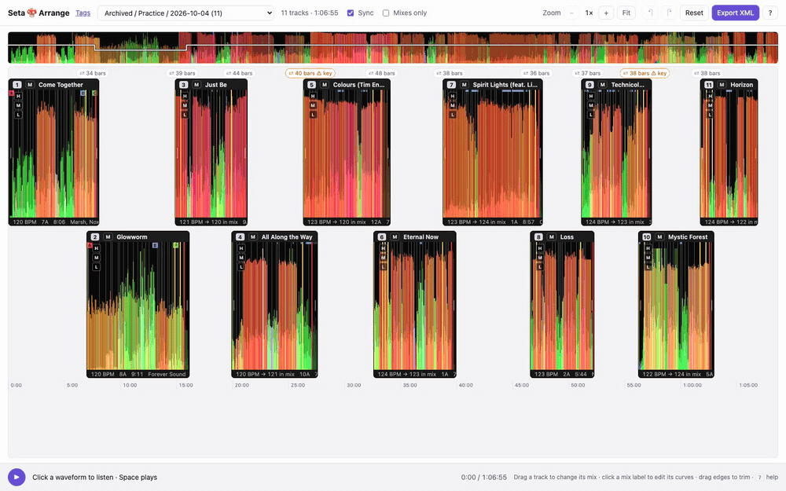
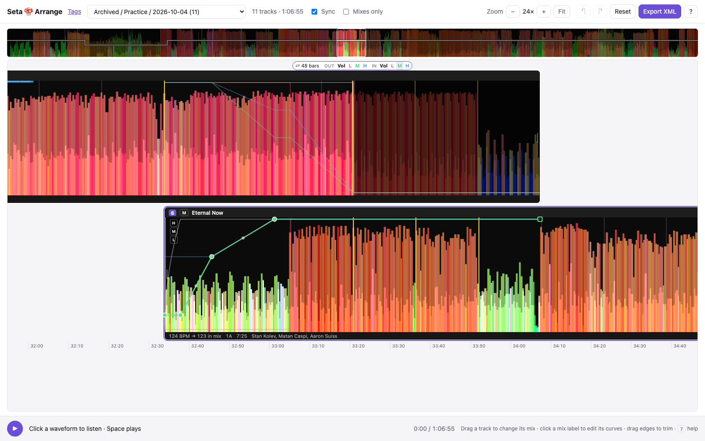

# Seta 🍄 web

**Plan and rehearse a DJ set in the browser, then send it to Rekordbox.** A local web app that reads your own library: explore tracks on a BPM × energy map, arrange a set on real waveforms, shape every transition with EQ curves, and listen to the whole set before you play it.


[](LICENSE)



## Why

I wanted to hear a set before playing it. Not a playlist, the actual transitions: when the next track comes in, when the bass swaps, whether two vocals clash. Seta does that on my own Mac with my own files, and hands the result to Rekordbox with the mix points already set as cues.

## Arrange a set


| | |
|---|---|
| **Real waveforms** | Pick any Rekordbox playlist. Tracks show with Rekordbox's own 3-band waveforms, beat grid and phrases. |
| **Synced mixes** | The incoming track enters at the outgoing tempo, holds it through the mix, then glides back to its own BPM. Mixes start on a phrase. |
| **Mix curves** | Every transition has volume, low, mid and high lines for both tracks. A default recipe follows DJ practice (one bassline at a time, bass swap on a phrase); drag points to change it. |
| **Warnings** | Flags key clashes, mixes that are too short, and vocal overlaps (from Rekordbox's vocal detection). |
| **Mixes only** | Skip the middle of each track and listen to the transitions back to back. |
| **Sounds like a set** | Web Audio playback, sample-accurate, time-stretched with SoundTouch, loudness-matched to −9 LUFS, with a limiter on the master. |
| **Export to Rekordbox** | One click writes a Rekordbox XML with the order and every mix point as memory cues. Earlier exports and the Rekordbox library are backed up first. |



## Explore the library

- **Mix map**: every track placed by BPM (x) and energy (y), colored by Camelot key, with set zones (warm up, groove, peak…) behind.
- **Mix hints**: pick a track to see what mixes well next, by key, tempo and energy.
- **Set draft**: shortlist tracks, mark finals, sort by energy or BPM, export M3U.
- **Tags**: read and edit Rekordbox energy stars and My Tags, with filters.
- Keyboard first: press `?` on any page.

## Quick start

Needs macOS, Python 3.10+ and a music folder. Rekordbox is optional but unlocks Arrange.

```bash
git clone https://github.com/manupastorr/seta-web.git
cd seta-web
./start.sh
```

`start.sh` creates a `.venv`, installs `requirements.txt`, scans your music, and starts the server. Open the URL it prints (default http://127.0.0.1:8765). Rescans reuse the per-file cache.

Default music folders: `~/Music/tracks` and `~/Downloads/To Curate`. To change them:

```bash
cp .env.example .env   # then edit SETA_TRACKS_ROOT / SETA_CURATE_ROOT / SETA_PORT
```

Supported audio: `.wav`, `.aiff`, `.aif`, `.flac`, `.mp3`.

## How it is built

| Piece | Role |
|---|---|
| `scan_library.py`, `analyze.py` | Walk the folders and analyze each track with librosa: BPM with confidence, Camelot key, phrase-based energy curve, vocals hint, waveform peaks. |
| `rekordbox.py`, `rb_waveform.py`, `rb_tags.py` | Read Rekordbox's database and analysis files: playlists, beat grids, phrases, waveforms, My Tags. |
| `rb_xml.py`, `arrange_store.py` | Rekordbox XML export with cues; arrangements saved on the Mac with full history. |
| `server.py` | Flask API, audio streaming, UI. |
| `static/` | D3 map, Arrange timeline, Web Audio mixer (`mixRecipe.js`, `tempoMap.js`, `loudness.js`, `stretchWorker.js`). |

Nothing leaves your machine. Analysis is for exploring; when BPM confidence is low, trust Rekordbox.

## Tests

```bash
.venv/bin/python -m unittest discover -s tests -v
node --test tests/*.mjs
```

76 Python and 51 JavaScript tests cover analysis, Camelot scoring, the mix recipe, tempo maps, loudness (checked against the BS.1770 997 Hz calibration tone), Rekordbox parsing and the arrangement store.

## Related

[SetaMac](https://github.com/manupastorr/seta-mac) is the native macOS app for the first phase: map your library and draft a set, no Terminal needed.

## License

MIT. SoundTouch (`static/vendor/soundtouch.js`) is LGPL-2.1, license next to it. Made by [Manu Pastor](https://manupastor.de/dj/), a DJ who builds his own tools.
